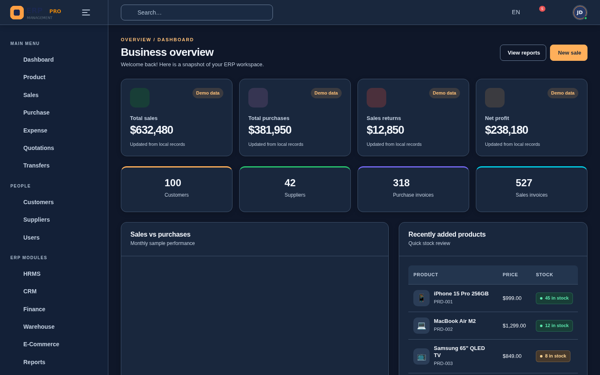
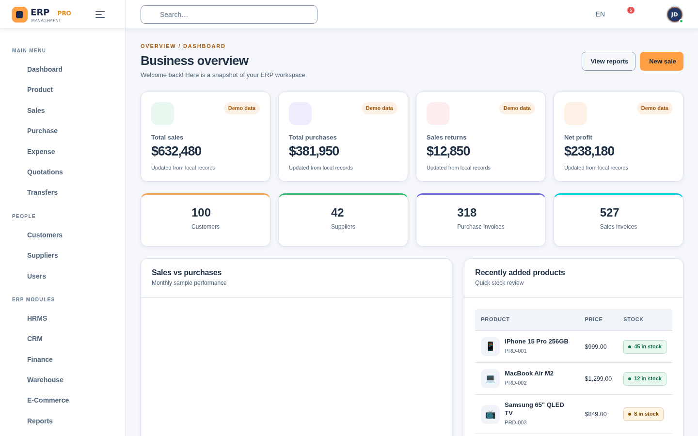
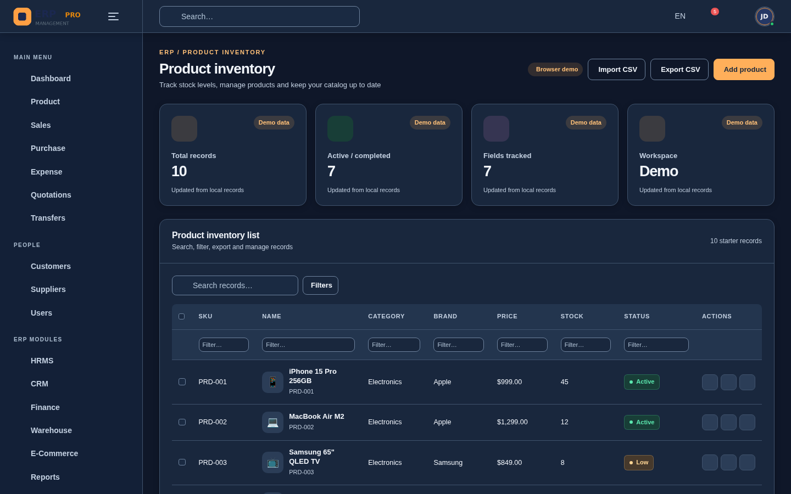
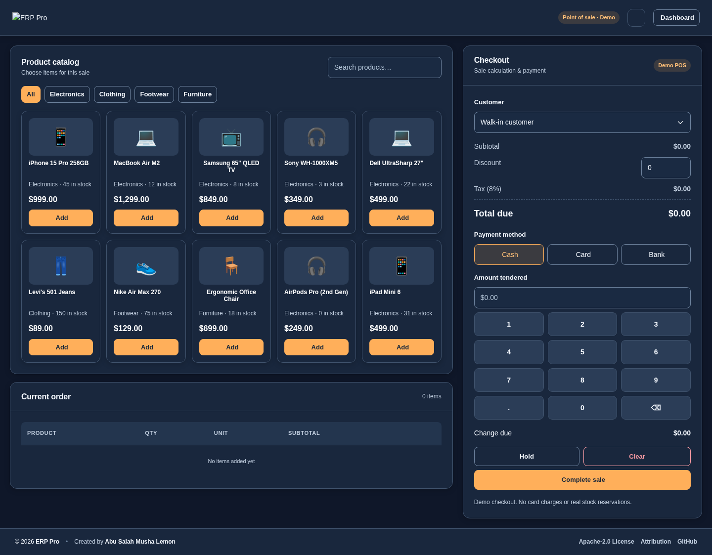
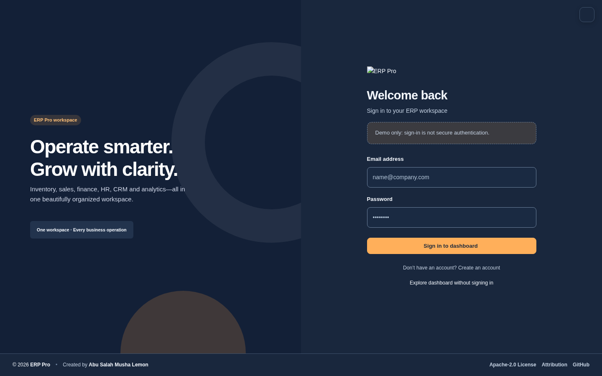

<div align="center">
  

  # ERP Pro — Admin Dashboard & POS

  ### A modern ERP, Inventory Management & Point-of-Sale frontend

  A responsive, multi-page administration interface for exploring retail, wholesale, and business management workflows — built with **HTML, CSS, JavaScript, and Bootstrap**.

  <p>
    
    
    
    <a href="LICENSE"></a>
    
    <a href="https://github.com/Abu-Salah-Musha-Lemon/ERP-Pro-Admin-Panel/actions/workflows/quality.yml"></a>
    <a href="https://github.com/Abu-Salah-Musha-Lemon/ERP-Pro-Admin-Panel/pkgs/container/erp-pro-admin-panel"></a>
  </p>

  **[Live demo](https://abu-salah-musha-lemon.github.io/ERP-Pro-Admin-Panel/)** · **[Source](https://github.com/Abu-Salah-Musha-Lemon/ERP-Pro-Admin-Panel)** · **[Docker image](https://github.com/Abu-Salah-Musha-Lemon/ERP-Pro-Admin-Panel/pkgs/container/erp-pro-admin-panel)**

  **Created by [Abu Salah Musha Lemon](https://github.com/Abu-Salah-Musha-Lemon)**

  [Features](#-features) · [Screenshots](#-screenshots) · [Quick start](#-quick-start) · [Docker](#-docker--github-packages) · [Modules](#-modules--pages) · [Documentation](#-documentation) · [License](#-license--attribution)
</div>

> [!IMPORTANT]
> **ERP Pro v3.1.0 is a frontend demonstration, not a production-ready ERP.** Sign-in and permissions are UI simulations; sample records are stored in browser `localStorage`. No production backend, database, payment gateway, or secure authentication is included. **Do not enter real credentials or business-sensitive information.**

## ✨ Features

| Experience | What's included |
| :--- | :--- |
| **Professional dashboard** | KPI cards, analytics charts, activity information, and shortcuts based on sample data |
| **Responsive navigation** | Desktop sidebar, compact sidebar, mobile drawer, submenu support, and active-page highlighting |
| **Light & dark themes** | Persistent theme preference; consistent card, table, field, dropdown, and border colors |
| **Inventory management** | Product list and forms, categories, brands, stock examples, and barcode generation |
| **Sales & purchasing** | Sales and purchase records, forms, return pages, expenses, quotations, and transfers |
| **Interactive demo POS** | Product selection, cart, quantity changes, discounts, tax, cash/change, held orders, and printable receipt |
| **Business modules** | CRM, HRMS, finance, warehouse, e-commerce, reporting, and configuration screens |
| **Records & exports** | Search, filters, pagination, demo CRUD, bulk actions, CSV import/export, and CDN-enabled table exports |
| **User experience** | Toast notifications, confirmation dialogs, form feedback, and keyboard-friendly controls |
| **Copyright & funding-ready** | Responsive author-credit footer on all 32 pages and an optional future external Donate link |

> The interface and some CRUD/POS flows are interactive **demos**. Dashboard totals, payroll, finance reports, permissions, payment settings, and several business operations are illustrative rather than connected to real services.

## 🖼️ Screenshots

### Dashboard — dark and light modes

| Dark mode | Light mode |
| :---: | :---: |
|  |  |

### Inventory management



<details>
<summary><strong>More screenshots — footer, POS and authentication</strong></summary>

| POS terminal (dark) | Sign-in (dark) |
| :---: | :---: |
|  |  |

</details>

## 🚀 Quick start

**Requirements:** A modern desktop or mobile browser. Internet access is needed for full operation of the CDN-loaded libraries. **No npm, build step, or database is required** for the demo.

### Option 1 — open the HTML directly

1. Download the source ZIP from the GitHub repository.
2. Extract it, keeping the entire project directory together.
3. Open `index.html` in Chrome, Edge, or Firefox.

### Option 2 — use a local server (recommended)

From the project root, where `index.html` and `README.md` are located:

```bash
# Python 3
python -m http.server 8000

# On Windows, this also works when Python Launcher is installed:
# py -m http.server 8000
```

Open **http://localhost:8000**.

To clone with Git instead, copy the actual clone URL from your GitHub repository's **Code** menu:

```bash
git clone https://github.com/Abu-Salah-Musha-Lemon/ERP-Pro-Admin-Panel.git
cd ERP-Pro-Admin-Panel
python -m http.server 8000
```

**Demo login:** `signin.html` is a visual demonstration. An email-formatted input and a password of at least six characters will let you preview the interface. It does **not** authenticate against a server; never enter your real password.

## 🐳 Docker & GitHub Packages

A public versioned container is available through [GitHub Container Registry (GHCR)](https://github.com/Abu-Salah-Musha-Lemon/ERP-Pro-Admin-Panel/pkgs/container/erp-pro-admin-panel). No backend or database is included in the image; it serves the static frontend through an unprivileged Nginx server.

**Run the published `v3.1.0` image** (Docker Desktop or Docker Engine required):

```powershell
docker pull ghcr.io/abu-salah-musha-lemon/erp-pro-admin-panel:v3.1.0
docker run -d --name erp-pro -p 8000:8080 ghcr.io/abu-salah-musha-lemon/erp-pro-admin-panel:v3.1.0
```

Open **http://localhost:8000**. Confirm the server response and container status:

```powershell
curl.exe -I http://localhost:8000/
docker ps
docker logs --tail 30 erp-pro
```

The project owner verified the published image on Windows using **`-p 8000:8080`**: the container was running with Nginx listening on port **8080** and `curl.exe` returned **HTTP 200 OK**. Docker maps `HOST_PORT:CONTAINER_PORT`; `-p 8000:8000` was incorrect for this image. An HTTP 200 response does **not** verify every frontend interaction.

**Stop and remove the demo container:**

```powershell
docker stop erp-pro
docker rm erp-pro
```

**Build from source**, if preferred:

```bash
docker build -t erp-pro:local .
docker run --rm -p 8000:8080 erp-pro:local
```

For other platforms, deployment and rollback, see [Deployment Guide](docs/DEPLOYMENT.md). Pin a version tag or digest for reproducible deployments rather than relying on `latest`.

## 🧩 Modules & pages

The repository contains **32 standalone HTML pages**.

| Area | Pages | Purpose |
| :--- | :--- | :--- |
| **Dashboard** | `index.html` | Overview and sample analytics |
| **Products** | `inventory.html`, `addproduct.html`, `categorylist.html`, `brandlist.html`, `barcode.html` | Catalog and inventory UI |
| **Sales** | `sales.html`, `add-sales.html`, `salesreturnlist.html`, `pos.html` | Sales and POS demo |
| **Purchases** | `purchase.html`, `addpurchase.html`, `purchasereturnlist.html` | Purchasing and returns |
| **Operations** | `expense.html`, `quotation.html`, `transfer.html` | Expenses, quotes, transfers |
| **People** | `customerlist.html`, `supplierlist.html`, `userlist.html` | Directory management |
| **ERP modules** | `hrms.html`, `crm.html`, `finance.html`, `warehouse.html`, `ecommerce.html`, `reports.html` | Enterprise management screens |
| **Account & settings** | `signin.html`, `signup.html`, `profile.html`, `activities.html`, `settings.html` | Account UI, preferences, activity |
| **Error pages** | `error-404.html`, `error-500.html` | Branded error states |

## 🧰 Technology stack

| Category | Technologies |
| :--- | :--- |
| UI & layout | HTML5, CSS3, Bootstrap 5.3.2, Bootstrap Icons, Font Awesome, Nunito |
| JavaScript | Vanilla JavaScript, jQuery 3.6.4 |
| Tables | DataTables 1.13.8, Responsive 2.5.0, Buttons 2.4.2 |
| Export | CSV support, JSZip, pdfmake |
| Charts | ApexCharts 3.45.2 |
| Form controls | Select2, Flatpickr |
| Notifications & dialogs | Toastr, SweetAlert2, Animate.css |
| Barcodes | JsBarcode |
| Demo storage | Browser `localStorage` |

Libraries are included through external CDN links, not a local package manager. Availability of third-party integrations depends on those services loading successfully.

## 📁 Project structure

```text
erp-pro-admin/
├── index.html                  # Dashboard entry point
├── inventory.html              # Inventory table and demo record actions
├── pos.html                    # Standalone point-of-sale interface
├── ...                         # Other module, account, and error pages
├── assets/
│   ├── css/
│   │   └── style.css           # Design tokens, themes, layouts, responsiveness
│   ├── js/
│   │   ├── script.js           # Shared UI behavior and demo workflows
│   │   ├── seed.js             # Mock records and example data
│   │   └── project-config.js   # Optional donation URL configuration
│   └── img/                    # Logo, icons, avatar, images
├── docs/
│   ├── screenshots/            # Screenshots embedded in this README
│   ├── DEVELOPER_GUIDE.md      # Architecture and backend migration notes
│   ├── GITHUB_SETUP.md         # Repository and release publishing guide
│   ├── TEST_REPORT_v3.0.1.md   # Historical frontend test report
│   ├── APPLICATION_TESTING.md  # Local/CI test instructions
│   └── APPLICATION_TEST_REPORT_v3.1.0.md  # Current test evidence
├── tests/                      # Static, responsive and application E2E tests
├── .github/workflows/
│   ├── quality.yml             # Checks on pushes, PRs and manual runs
│   └── publish-container.yml   # GHCR publication after a release
├── Dockerfile                  # Non-root Nginx static frontend image
├── .dockerignore               # Excluded files for image build
├── CHANGELOG.md
├── CONTRIBUTING.md
├── SECURITY.md
├── LICENSE
├── NOTICE
└── README.md
```

The HTML pages currently share CSS/JS files but repeat some layout markup. Before introducing a backend, see the [developer guide](docs/DEVELOPER_GUIDE.md) for the intended integration direction.

## 🎨 Themes & customization

- Toggle **night mode** using the moon/sun control in the header.
- The choice persists across pages in the same browser.
- Desktop supports an expanded or compact sidebar; mobile uses a slide-in drawer.
- Visual design variables, including backgrounds, text and border colors, are centralized in [`assets/css/style.css`](assets/css/style.css).
- Footer copyright and author attribution are available on all 32 pages.

When extending the design, reuse existing semantic CSS variables and check **both themes** rather than introducing hard-coded, conflicting colors.

## 💾 Data handling & security

ERP Pro seeds example data from `assets/js/seed.js` and saves changes in browser `localStorage` under project-specific keys beginning with `erpProDemoV2:`. POS checkout can update local demo inventory and sales, but that is **not a transaction-safe inventory ledger**.

| Available in the demo | Requires a backend for real deployment |
| :--- | :--- |
| Local record examples and editing | Shared database with backups and access controls |
| Visual sign-in and settings | Secure identity, sessions, and role-based authorization |
| Client-side cart and checkout simulation | Payment processing and server-validated financial transactions |
| Sample charts and financial figures | Reconciled accounting and authoritative reports |
| Browser-local changes | Multi-user synchronization, audit trail, stock ledger |

To reset demo edits, remove keys starting with `erpProDemoV2:` from your browser's site storage and reload the page. This **deletes changes saved in that browser**.

Review [`SECURITY.md`](SECURITY.md) before publishing a live demo or implementing an API. Do not commit credentials, secret keys, real customer records, or payment information to this repository.

## 🧪 Application testing & automated quality

Testing is implemented with Python, Playwright (Chromium), and pinned Bootstrap test resources. The following results were obtained from the **local source baseline**, with external CDNs disabled:

| Test group | Local result | Details |
| :--- | ---: | :--- |
| HTML/asset validation | **32/32 passed** | Page structure, links, assets, duplicate IDs |
| Footer/license checks | **32/32 passed** | Visible author credit, license and donation-hidden default |
| Responsive page checks | **192/192 passed** | 32 pages × 6 widths (320–1440 px) |
| Original interactive smoke tests | **11/11 passed** | Sidebar, night mode, inventory, exports, POS |
| Additional application E2E scenarios | **9/9 passed** | See list below |

The **9 additional scenarios** exercise inventory edit persistence, negative stock validation, search/export, theme and mobile navigation, insufficient-cash checkout blocking, POS sale and stock deduction, hold/resume, out-of-stock protection, and signup password mismatch validation.

### Run tests locally

```bash
python -m pip install playwright==1.56.0 beautifulsoup4==4.12.3
python -m playwright install chromium
npm install --no-save --package-lock=false bootstrap@5.3.2
python tests/validate_project.py
python tests/test_footer_release.py
python tests/browser_test.py
python tests/application_e2e.py
```

GitHub Actions executes the **Static validation**, **Browser smoke tests**, and **Application-level E2E (offline demo)** jobs for `main` pushes, pull requests targeting `main`, and manual runs. Its release workflow requires quality checks before publishing versioned Docker images to GHCR.

**Scope and limitations:** Local tests above do not represent new live tests of the current GitHub repository or the running GHCR image. The GHCR image was separately confirmed by the owner to return HTTP 200. No real backend, payment security, full live-CDN integration, or cross-browser acceptance testing has been performed.

- [Application Testing Guide](docs/APPLICATION_TESTING.md) — setup, automation, coverage, manual release acceptance.
- [Application Test Report v3.1.0](docs/APPLICATION_TEST_REPORT_v3.1.0.md) — exact passed checks and exclusions.
- [Deployment Guide](docs/DEPLOYMENT.md) — GitHub Pages, Docker, GHCR, port mapping, rollback.
- [Release Process](docs/RELEASE_PROCESS.md) — version tags and release checklist.
- [Quality Workflow](.github/workflows/quality.yml) · [GHCR Workflow](.github/workflows/publish-container.yml).

## 🗺️ Roadmap

The following items are **proposed improvements, not released functionality**:

- [ ] Introduce reusable shared layout components instead of repeated header/sidebar HTML.
- [ ] Add an API and database (Laravel, Django, Node.js, or another suitable backend).
- [ ] Implement secure authentication, role-based permissions and audit logs.
- [ ] Add transactional inventory movements across purchases, sales, returns, and warehouses.
- [ ] Connect verified payment providers and real invoicing/reconciliation.
- [ ] Expand automated browser test coverage, accessibility checks and dependency auditing (basic GitHub Actions CI is included in this source update).
- [ ] Enable an optional donation link after a verified provider account is ready.

## 🤝 Contributing

Issues, bug reports and pull requests are welcome. For development conventions and submission instructions, read [`CONTRIBUTING.md`](CONTRIBUTING.md). For responsible security disclosure guidance, see [`SECURITY.md`](SECURITY.md).

The project release history is tracked in [`CHANGELOG.md`](CHANGELOG.md), with release-specific details in [`RELEASE_NOTES_v3.1.0.md`](RELEASE_NOTES_v3.1.0.md).

## ❤️ Support the Project

If you find **ERP Pro** useful, consider giving this repository a ⭐ **star**, sharing it with others, or contributing improvements to help the project grow.

## 📄 License & attribution

Copyright © 2026 **Abu Salah Musha Lemon**.

ERP Pro's original project code is licensed under the **[Apache License 2.0](LICENSE)**. Personal use, commercial use, modification, and redistribution are allowed **subject to the license conditions**, including preservation of relevant license, copyright, and attribution notices. Read [`NOTICE`](NOTICE) for the author's attribution statement. Third-party libraries retain their own licenses.

**Important:** Apache-2.0 does **not** require every derivative application's footer to visibly display the original author's name at all times; it requires the applicable notices to be retained as the license specifies.

---

<div align="center">

**ERP Pro — A flexible frontend foundation for business management dashboards.**

Made by **[Abu Salah Musha Lemon](https://github.com/Abu-Salah-Musha-Lemon)** · **v3.1.0** · **Apache-2.0**

</div>
